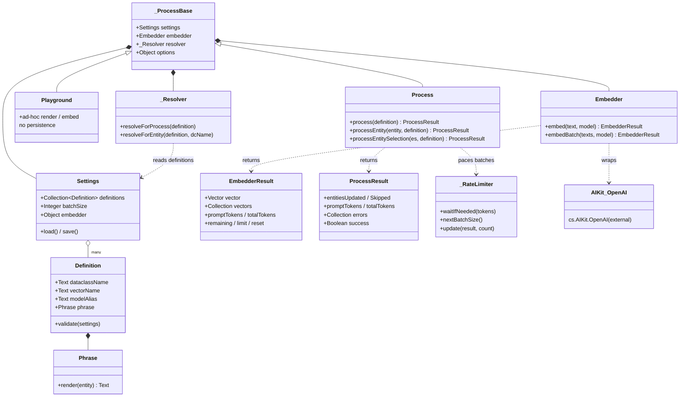
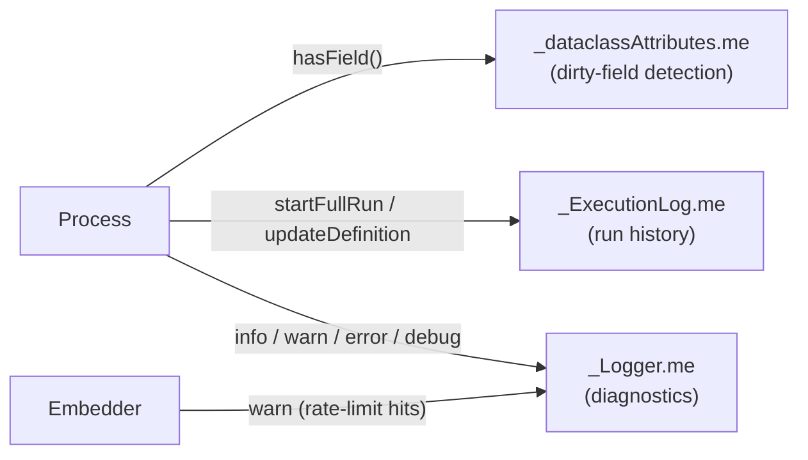
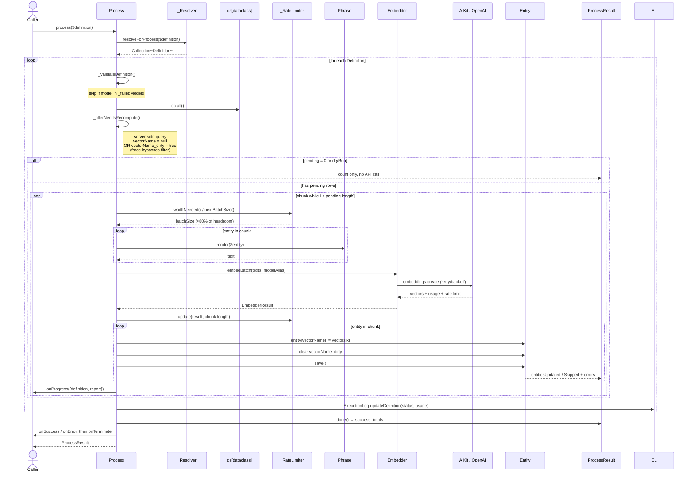

# Architecture

This document is the **map** of 4D Embedding Studio: how the classes fit together and how
data flows from configuration to persisted `4D.Vector` values. For the **territory** — the
full API of each class — follow the links into `Classes/`.

The component is a layered pipeline:

- **Configuration** — [`Settings`](Classes/Settings.md) holds a collection of
  [`Definition`](Classes/Definition.md), each owning a [`Phrase`](Classes/Phrase.md)
  template.
- **Orchestration** — [`Process`](Classes/Process.md) (batch / persisting) and
  [`Playground`](Classes/Playground.md) (ad-hoc / non-persisting) both extend
  `_ProcessBase`, which wires the shared configuration, embedder, and resolver.
- **API layer** — [`Embedder`](Classes/Embedder.md) wraps the 4D AIKit client and returns
  a [`EmbedderResult`](Classes/EmbedderResult.md).
- **Support** — `_Resolver`, `_RateLimiter`, `_ExecutionLog`, `_Logger`, and
  `_dataclassAttributes` handle argument normalization, batch pacing, run history,
  diagnostics, and schema introspection.

## Component / class relationships

The pipeline also leans on three **singletons**, reached through a shared `.me` accessor
rather than constructor injection (see REVIEW §9). They are global state, not composed
instances:

## Data flow — `Process.process()`

The batch pipeline is **resolve → validate → filter → chunk → render → embed → persist**.
The sequence below traces a full run; method names map directly to
[`Process.4dm`](../Project/Sources/Classes/Process.4dm).

### Notes on the flow

- **Polymorphic input.** `$definition` may be `Null` (= all definitions in settings), a
  single `Definition`, a collection, a `4D.DataClass`, or a plain `{dataclassName,
  vectorName, …}` stub. `_Resolver` flattens all of these to concrete `Definition`s.
- **Server-side filtering.** Rows already embedded and not dirty are excluded by an ORDA
  query *before* any text is rendered, so they never reach the API. `force: true` bypasses
  this; `dryRun: true` runs everything except writes and API calls (useful for cost/scope
  estimation).
- **Adaptive batching.** Chunk size starts at `settings.batchSize` and is then driven by
  `_RateLimiter`, which parses OpenAI-style reset headers and trims batches to ~80% of the
  remaining budget. See [RateLimit.md](RateLimit.md) for the algorithm.
- **Positional zip.** `embedBatch` returns vectors in input order; `_processChunk` maps
  `vectors[k]` back to `chunk` entity #`k`, then saves one entity at a time (4D entity
  saves are atomic). A vector-count mismatch fails the whole chunk safely.
- **Dirty flag.** When a `<vectorName>_dirty` Boolean field exists, it is cleared on
  successful save; on save failure it is left set so the row is retried next run.
- **Error isolation.** A non-critical error is recorded per entity/chunk and the run
  continues. A *critical* API error adds the model to `_failedModels`, so remaining
  definitions using that model are skipped instead of hammering a broken endpoint.
- **Single-entity fast path.** `processEntity()` routes through `_runOnEntity()` — no
  chunking, no server-side filter, no rate limiter — ideal for on-save triggers and REST
  hooks.

## Class responsibilities

| Class | Kind | Responsibility | Source |
|---|---|---|---|
| [`Process`](Classes/Process.md) | public | Batch / entity / selection orchestration; filtering, chunking, persistence, callbacks. | [Process.4dm](../Project/Sources/Classes/Process.4dm) |
| [`Playground`](Classes/Playground.md) | public | Ad-hoc, non-persisting phrase rendering and one-off vector computation. | [Playground.4dm](../Project/Sources/Classes/Playground.4dm) |
| [`Settings`](Classes/Settings.md) | public | Load/save `vectors.json`; holds `definitions`, `batchSize`, `phrase` and `embedder` config. | [Settings.4dm](../Project/Sources/Classes/Settings.4dm) |
| [`Definition`](Classes/Definition.md) | public | One vector field: dataclass, vector name, model alias, phrase; validation and invalidation. | [Definition.4dm](../Project/Sources/Classes/Definition.4dm) |
| [`Phrase`](Classes/Phrase.md) | public | `{variable}` template engine — compiles and renders text from entity attributes. | [Phrase.4dm](../Project/Sources/Classes/Phrase.4dm) |
| [`Embedder`](Classes/Embedder.md) | public | Thin AIKit wrapper for `embed`/`embedBatch` with retry and backoff. | [Embedder.4dm](../Project/Sources/Classes/Embedder.4dm) |
| [`EmbedderResult`](Classes/EmbedderResult.md) | public | Normalizes API responses — vectors, token usage, rate-limit state (camelCase). | [EmbedderResult.4dm](../Project/Sources/Classes/EmbedderResult.4dm) |
| [`ProcessResult`](Classes/ProcessResult.md) | public | Per-run statistics and flat error collection; `success` flag. | [ProcessResult.4dm](../Project/Sources/Classes/ProcessResult.4dm) |
| `_ProcessBase` | private | Shared base: builds embedder (incl. custom `className`), wires settings/resolver/options. | [_ProcessBase.4dm](../Project/Sources/Classes/_ProcessBase.4dm) |
| `_Resolver` | private | Normalizes the polymorphic `$definition` argument into concrete `Definition`s. | [_Resolver.4dm](../Project/Sources/Classes/_Resolver.4dm) |
| `_RateLimiter` | private | Parses reset headers, adapts batch size to remaining budget, pre-flight throttling. | [_RateLimiter.4dm](../Project/Sources/Classes/_RateLimiter.4dm) |
| `_ExecutionLog` | singleton | Records per-definition and full-run history (status, timing, usage). | [_ExecutionLog.4dm](../Project/Sources/Classes/_ExecutionLog.4dm) |
| `_Logger` | singleton | Structured diagnostic logging (info/warn/error/debug). | [_Logger.4dm](../Project/Sources/Classes/_Logger.4dm) |
| `_dataclassAttributes` | singleton | Cached schema introspection — e.g. whether a `<vectorName>_dirty` field exists. | [_dataclassAttributes.4dm](../Project/Sources/Classes/_dataclassAttributes.4dm) |

## See also

- [README](../README.md) — quick start.
- [Process](Classes/Process.md) — entry points and options.
- [Settings](Classes/Settings.md) — configuration file format (incl. custom embedder).
- [RateLimit](RateLimit.md) — adaptive batching algorithm.
